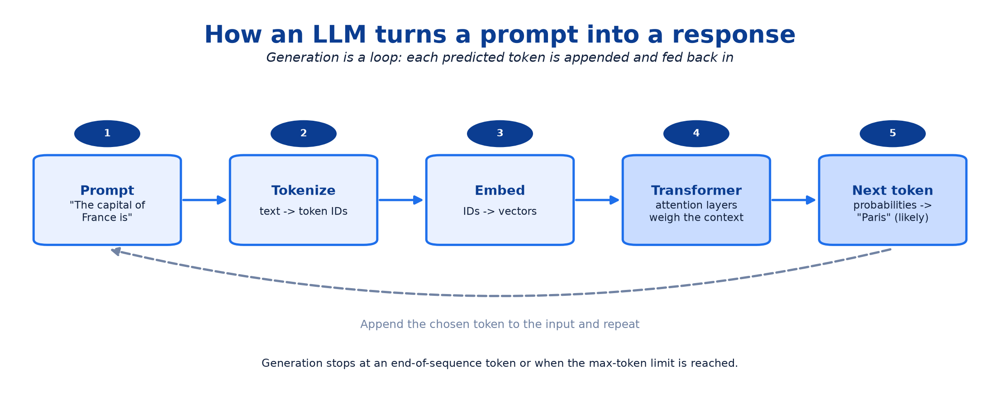
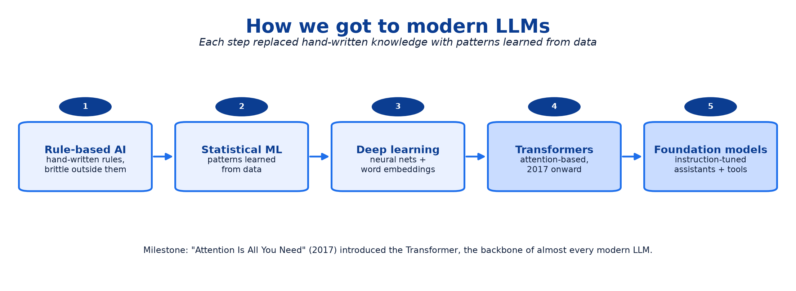
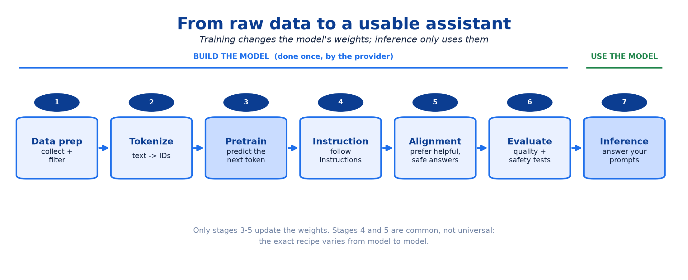
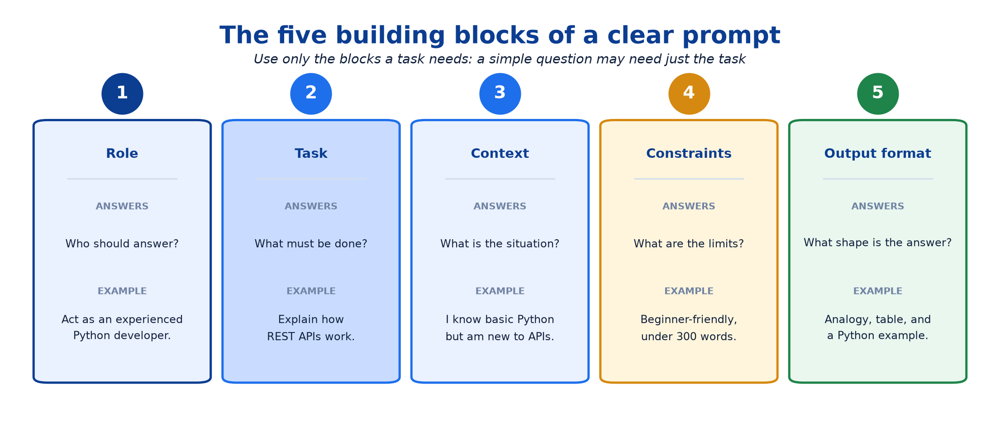
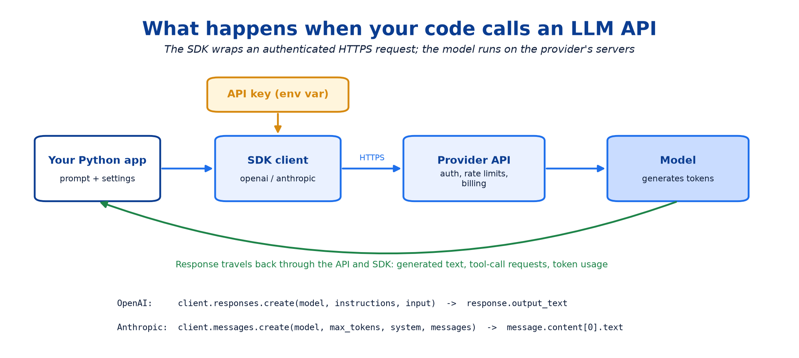
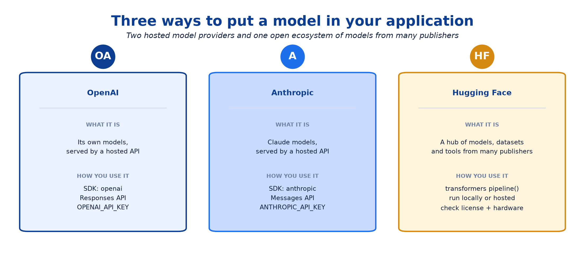
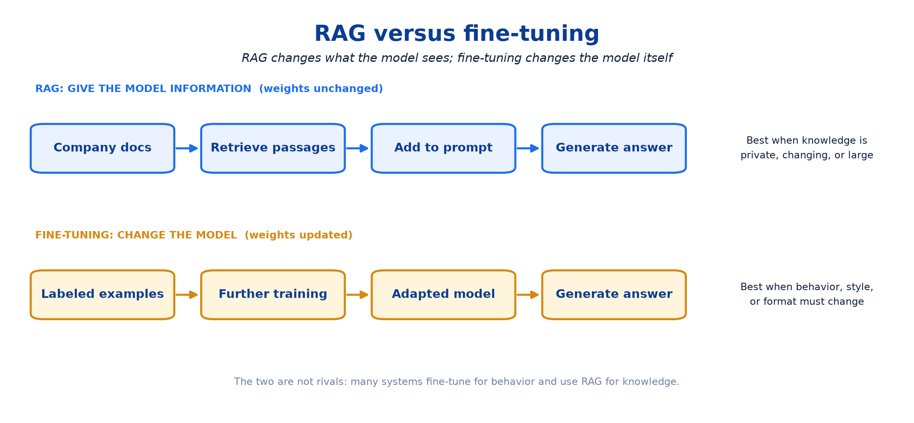
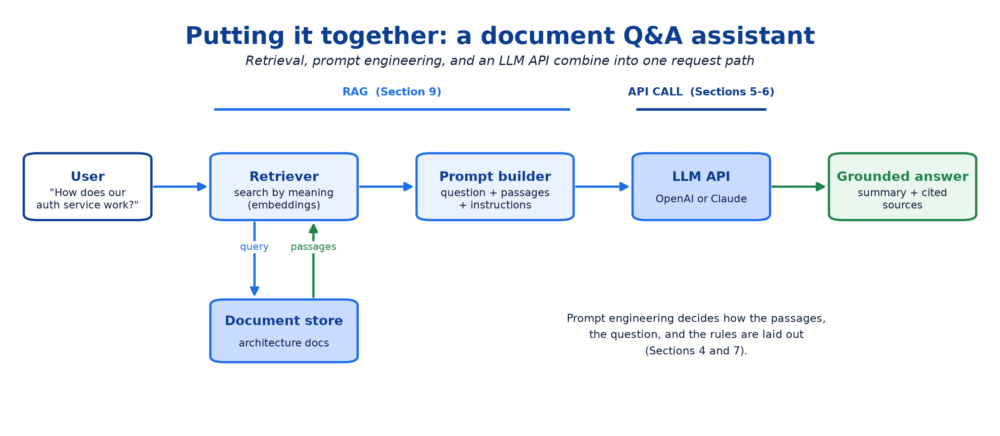

# LLM Models & APIs

## Terms to know before you start

You do not need to memorize these. Come back to this table whenever a term feels unfamiliar. LLM-specific concepts (tokens, attention, temperature, and so on) get their own table in Section 2.

| Term | What it means in plain words |
|---|---|
| **API** (application programming interface) | A defined way for one program to ask another program to do something. Here, your Python code sends a prompt and an LLM service sends back a response. |
| **SDK** (software development kit) | A library, such as `openai` or `anthropic`, that wraps the raw HTTP calls of an API in friendly Python functions. |
| **API key** | A secret string that proves to the provider who is calling and who should be billed. Treat it like a password. |
| **Environment variable** | A named value set in your shell (for example `OPENAI_API_KEY`) that programs can read, so secrets never have to be written in source code. |
| **Hosted model** | A model that runs on the provider's servers. You reach it only through its API and never download its weights. |
| **Open-weight model** | A model whose trained weights are published under a license, so eligible users can download, run, or adapt it themselves. |
| **Model ID** | The exact name you pass in code to pick a model, such as `gpt-6-astra`. IDs change as providers release new models. |
| **JSON / schema** | JSON is a text format for structured data; a schema describes which fields it must contain. Used when you need machine-readable output. |

---

## 1. What an LLM is and how it generates text

A **Large Language Model (LLM)** is an AI model trained on very large amounts of text (and often code) to learn the patterns of language. At its core it is an extremely capable **next-token predictor**: given `The capital of India is`, it predicts that `New Delhi` is the most likely continuation. Scaled up, that one skill becomes answering questions, writing code, summarizing documents, and much more.



| Step | What happens |
|---|---|
| **1. Prompt** | You send text, such as `The capital of France is`. |
| **2. Tokenize** | The text is split into tokens, and each token becomes a numeric ID. |
| **3. Embed** | Each ID is turned into a vector, a list of numbers the network can work with. |
| **4. Transformer layers** | Attention and other operations relate every token to the rest of the context. |
| **5. Next token** | The model outputs a probability for every possible next token (`Paris` scores high) and one is chosen. |

The chosen token is appended to the input and the loop repeats, which is why answers appear word by word. Generation stops at an end-of-sequence token or a maximum-length limit.

!!! tip "The LLM in one sentence"
    An LLM does not look facts up; it predicts likely next tokens from patterns learned during training. That is why it is fluent, and also why it can be confidently wrong.

### Try it: text generation with a small model

```python
from transformers import pipeline

generator = pipeline("text-generation", model="distilbert/distilgpt2")
result = generator("Artificial intelligence is", max_new_tokens=30)

print(result[0]["generated_text"])
```

| Code | Meaning |
|---|---|
| `pipeline("text-generation", ...)` | Loads a ready-made generation workflow plus the model. |
| `"Artificial intelligence is"` | The starting text the model continues. |
| `max_new_tokens=30` | Caps how many new tokens are generated. |
| `generated_text` | The original text followed by the model's continuation. |

`distilgpt2` is a small, old model that continues text; it is not an instruction-following assistant, so expect rambling output that changes between runs. The first run downloads the model (Hugging Face is covered in Section 8).

---

## 2. Essential LLM concepts

These terms appear in every LLM tutorial, API reference, and model card. They are grouped by where they fit in the life of a model.

### How text becomes numbers

| Concept | Simple explanation | Example |
|---|---|---|
| **Token** | A small piece of text the model processes: a whole word, part of a word, or punctuation. | GPT-2's tokenizer splits `"Learning AI"` into `Learning` and ` AI` (the space belongs to the second token). |
| **Tokenization** | Converting text into tokens and then into numeric token IDs. | GPT-2: `"I love AI"` → `I`, ` love`, ` AI` → `[40, 1842, 9552]`. |
| **Embedding** | A vector of numbers representing a token (or a whole text) so that related meanings end up close together. | `king` and `queen` have related embeddings. |
| **Context window** | The maximum number of tokens (prompt + conversation + answer) the model can consider at once. | In a very long chat, early messages must be dropped or summarized. |

### How the model is built

| Concept | Simple explanation | Example |
|---|---|---|
| **Parameters (weights)** | The numbers learned during training that determine the model's behavior. | A "70B" model has about 70 billion of them. More is not automatically better. |
| **Training** | Adjusting the parameters so the model's predictions get better on data. | Repeatedly predicting the next token and correcting mistakes. |
| **Pretraining** | The first, largest training stage on broad data, which teaches general patterns. | Learning grammar, facts, and coding patterns. |
| **Fine-tuning** | Further training of a pretrained model on selected examples for a specific behavior or task. | Training on support conversations to improve support replies. |
| **Transformer** | The neural network architecture behind most modern LLMs, built around attention. | GPT, Claude, Llama, and BERT are all Transformer-based. |
| **Attention** | The mechanism that lets each token weigh how relevant every other token is. | In "The cat sat on the mat because it was tired", attention links `it` to `cat`. |

### How you use the model

| Concept | Simple explanation | Example |
|---|---|---|
| **Inference** | Running an already-trained model to get an answer. Weights do not change. | Asking an assistant to explain a Python function. |
| **Next-token prediction** | Choosing a likely next token from the context, one token at a time. | `"The sun rises in the"` → `east`. |
| **Temperature** | A sampling setting: lower values give more predictable output, higher values more variety. Not every model or API exposes it. | Low for code and extraction; higher for brainstorming. |
| **System prompt** | Standing instructions that set the model's role, rules, and tone for a conversation. | "Act as a Python tutor. Use simple examples." |
| **Multimodal model** | A model that accepts or produces more than text: images, audio, or video. | Upload a screenshot and ask what the error means. |
| **Hallucination** | Output that sounds convincing but is wrong, unsupported, or invented. | Citing a paper or an API method that does not exist. |

!!! warning "Training, inference, and prompting are different things"
    **Training** changes the model's weights. **Inference** uses the weights without changing them. **Prompt engineering** steers inference through the input alone, so it costs nothing to iterate and never alters the model.

---

## 3. How we got here, and how an LLM is trained

### The road to modern LLMs



| Era | Core idea | Limitation it removed |
|---|---|---|
| **Rule-based AI** | Experts wrote explicit rules. | None yet: rules broke on anything their authors did not anticipate. |
| **Statistical ML** | Systems learned patterns from data. | Removed the need to hand-write every rule. |
| **Deep learning + embeddings** | Neural networks learned rich patterns, including vector representations of words. | Captured meaning and similarity, not just counts. |
| **Transformers (2017 onward)** | Attention processes all tokens in parallel and relates them directly. | Scaled to huge datasets and long contexts far better than earlier sequence models. |
| **Foundation models and assistants** | One large pretrained model is adapted to follow instructions, write code, and use tools. | One model serves many tasks instead of one model per task. |

The turning point was the 2017 paper *Attention Is All You Need*, which introduced the Transformer.

### The training pipeline



| Stage | What happens | Simple example |
|---|---|---|
| **Data preparation** | Collect, filter, and clean training data. | Gathering text, code, and documents; removing junk and duplicates. |
| **Tokenization** | Convert the data into token IDs. | Turning sentences into model-readable input. |
| **Pretraining** | Learn general patterns, usually by predicting the next token. | Learning grammar, code structure, and relationships between concepts. |
| **Instruction tuning** | Train on examples of instructions paired with good responses. | Learning to answer the question asked instead of just continuing text. |
| **Preference / alignment training** | Further training that favors helpful, honest, and safe responses (for example, RLHF: reinforcement learning from human feedback). | Preferring a useful answer over an evasive or harmful one. |
| **Evaluation** | Test quality, reliability, and safety. | Measuring accuracy on coding or reasoning benchmarks. |
| **Inference** | Use the finished model. | Your application calling the model through an API. |

Not every model follows this exact recipe. Instruction tuning and preference training are common, not mandatory.

??? info "Go deeper (optional): landmark papers from the course reading list"
    The course's "old but comprehensive overview" pre-read is Naveed et al. (2023), *A Comprehensive Overview of Large Language Models* (arXiv:2307.06435). The research milestones it surveys:

    | Year | Paper / model | Why it matters |
    |---:|---|---|
    | 2017 | Christiano et al., *Deep RL from Human Preferences* | The foundation of RLHF. |
    | 2018 | GPT-1, *Improving Language Understanding by Generative Pre-Training* | Pretrain on unlabeled text, then fine-tune. |
    | 2018 | BERT | Encoder-only, bidirectional pretraining for understanding tasks. |
    | 2019 | GPT-2, *Language Models are Unsupervised Multitask Learners* | Scale alone produced surprising zero-shot abilities. |
    | 2019 | T5 and BART | Encoder-decoder models that frame every task as text-to-text. |
    | 2020 | GPT-3, *Language Models are Few-Shot Learners* | Few-shot prompting without any fine-tuning. |
    | 2022 | InstructGPT | Instruction tuning + RLHF: the recipe behind ChatGPT. |
    | 2023 | LLaMA, GPT-4, Gemini | Strong open-weight models; large multimodal models. |
    | 2024 | Claude 3 family, OpenAI o1 | Model tiers by cost and speed; models trained to reason before answering. |
    | 2025 | DeepSeek-R1 | Reasoning ability trained mainly through reinforcement learning. |

---

## 4. Prompt engineering basics

**Prompt engineering** is designing the instructions and context you give an LLM so that it returns useful, accurate, and well-formatted responses. A *prompt* is everything you send: a question, instructions, background, examples, or any mix of these.

The model cannot read your mind. Compare:

| Prompt | What the model has to guess |
|---|---|
| `Explain APIs.` | Your level, the depth you want, the format, and the length. |
| `Explain APIs to a beginner using a real-world analogy and a Python example. Keep it concise.` | Almost nothing: audience, approach, example type, and length are all stated. |

A clearer prompt makes a good answer more likely. It does not make the answer automatically correct.

### The five building blocks



These are building blocks, not mandatory fields. A simple question may need only a task; a complex task benefits from all five. Combined, the example above reads:

```text
Act as an experienced Python developer.          <- role
Explain how REST APIs work.                      <- task
I know basic Python but am new to HTTP APIs.     <- context
Keep it beginner-friendly and under 300 words.   <- constraints
Use a real-world analogy, a simple diagram,
and a short Python example.                      <- output format
```

### Core techniques

| Technique | What it means | Example |
|---|---|---|
| **Zero-shot** | Ask for the task with no examples. | `Classify this review as positive or negative: "The service was excellent."` |
| **Few-shot** | Show a few input/output examples, then the new input. | Two labeled reviews, then an unlabeled one (see below). |
| **Role prompting** | Set the perspective the model should take. | `Act as a senior software architect.` |
| **Contextual prompting** | Supply the facts the model needs. | `The service handles 10,000 requests per second. Review its scalability.` |
| **Structured output** | Ask for an exact format. | `Return JSON with the fields name, status, and reason.` |
| **Task decomposition** | Split a complex task into ordered steps. | `First find the bottleneck, then compare fixes, then recommend one.` |
| **Iterative prompting** | Refine based on the previous answer. | `Too technical. Rewrite it with a simple analogy.` |

Zero-shot *tells* the model what to do; few-shot *shows* it:

```text
Review: "Terrible service."
Sentiment: Negative

Review: "Absolutely loved it."
Sentiment: Positive

Review: "The food was delicious."
Sentiment:
```

The model continues the pattern and answers `Positive`.

### Common mistakes

| Mistake | Why it hurts | Better approach |
|---|---|---|
| Vague instructions | The model interprets the task its own way. | State the expected outcome explicitly. |
| Missing context | The model makes wrong assumptions about your situation. | Include relevant background and constraints. |
| Many unrelated instructions in one blob | Requirements get dropped. | Organize instructions into clear sections. |
| No output format | The answer is hard to use or parse. | Ask for a table, JSON, code, or another specific format. |
| Trusting every answer | LLMs produce convincing errors. | Verify important claims against sources or tests. |
| Changing everything at once | You cannot tell which change helped. | Refine one aspect at a time. |

### Worked example: from "Review this code." to a useful review

```text
Act as a senior Python developer. Review the following code for bugs,
readability, performance, and security.

For each issue:
- Explain the problem in simple terms.
- Suggest a specific fix.
- Show the corrected code where necessary.

Do not rewrite code that is already correct. Keep the review concise and
prioritize critical issues.

Code:
[paste code here]
```

!!! question "Practice"
    Which change is most likely to improve an LLM's response?

    1. Make the prompt as long as possible.
    2. Provide clear instructions, relevant context, and the expected output format.
    3. Always assign the model an expert role.
    4. Repeat the same question several times.

??? success "Answer"
    **Option 2.** Clear instructions, relevant context, and a defined format directly tell the model what you need. Longer prompts and expert roles are not automatically better; they help only when they add information the model actually lacks.

---

## 5. OpenAI API quickstart

The **OpenAI API** lets your own code use OpenAI's models. ChatGPT is an *application* you talk to; the API is how you put the same kind of model *inside applications you build*, such as a script that reads an error log and returns a plain-English explanation.



Your code sends an authenticated HTTPS request; the provider checks your key, applies rate limits and billing, runs the model, and returns the result. The SDK hides the HTTP details.

### Setup in four steps

| Step | Command / action | Why |
|---|---|---|
| 1. Create an API key | Generate one at platform.openai.com/api-keys. | Authenticates your application. Never commit it to Git or ship it in frontend code. |
| 2. Install the SDK | `pip install openai` | Gives you the `OpenAI` client. |
| 3. Store the key | `export OPENAI_API_KEY="your_api_key_here"` (macOS/Linux) | The client reads it automatically, keeping the secret out of your code. |
| 4. Make a call | Run the script below with `python example.py`. | Proves the whole chain works. |

```python
from openai import OpenAI

client = OpenAI()  # reads OPENAI_API_KEY from the environment

response = client.responses.create(
    model="gpt-6-astra",
    input="Explain REST APIs in simple terms.",
)

print(response.output_text)
```

| Code | Meaning |
|---|---|
| `from openai import OpenAI` | Imports the client class. |
| `client = OpenAI()` | Creates a client; the key comes from the environment. |
| `client.responses.create(...)` | Sends a request to the **Responses API**, OpenAI's recommended API for new projects (text, tools, and multimodal input). |
| `model="gpt-6-astra"` | Chooses the model. |
| `input=...` | The prompt. |
| `response.output_text` | A convenience property holding all generated text. |

!!! warning "Model IDs change"
    `gpt-6-astra` is the ID used in OpenAI's quickstart as of October 2026. Models are renamed and retired regularly, so always confirm the current ID (and that your account can use it) in the provider's docs.

### Separate instructions from input

```python
response = client.responses.create(
    model="gpt-6-astra",
    instructions="Act as a senior software engineer. Explain technical concepts simply.",
    input="What is a REST API?",
)
```

`instructions` sets **how** the model behaves; `input` carries **what** to do. Keeping them apart lets an application reuse one behavior for many different user requests.

??? info "Go deeper (optional): Responses API vs Chat Completions"
    Older tutorials call `client.chat.completions.create(messages=[...])` and read `response.choices[0].message.content`. That Chat Completions API still exists, but OpenAI recommends the Responses API (`responses.create` + `output_text`) for new code. If a tutorial's code looks different from the example above, this is usually why.

### Key API concepts

| Concept | Simple explanation | Example |
|---|---|---|
| **Model** | The engine that processes your request; models differ in quality, speed, and cost. | Pick a strong model for code review, a cheaper one for simple tagging. |
| **Input / instructions** | What to do, and how to behave while doing it. | An error log as input; "be concise" as an instruction. |
| **Tokens** | Billing and limit units. Input and output tokens both count. | A long document costs more than a short question. |
| **Streaming** | Receive output as it is generated instead of all at the end. | Show a chat reply word by word. |
| **Conversation context** | Earlier turns are sent along so follow-up questions make sense. | "Now make that function async." |
| **Tool (function) calling** | The model asks *your code* to run a function and return the result. | The model requests a deployment-status lookup through your internal API. |
| **Structured outputs** | Force the response to match a JSON schema. | Always return `severity`, `cause`, and `suggested_fix`. |
| **Multimodal input** | Send images or files along with text. | Extract key figures from a PDF report. |

### Practical considerations

| Consideration | What you should know |
|---|---|
| **Cost** | API usage is billed separately from any ChatGPT subscription. Cost depends on the model, token counts, and tools used. |
| **Model selection** | Balance quality, latency, and cost against what the task actually needs. |
| **Rate limits** | Requests and tokens per minute are capped per model and account. |
| **Error handling** | Expect authentication failures, network errors, rate-limit errors, and temporary outages; retry with backoff where it is safe. |
| **Security** | Keep keys in environment variables or a secrets manager, never in source code or client-side apps. |
| **Data privacy** | Check data-use and retention policies before sending confidential information. |
| **Evaluation** | A successful API call is not a correct answer. Test outputs against representative examples. |

!!! warning "A ChatGPT subscription is not API credit"
    ChatGPT Plus or Team does not pay for API calls. Set up API billing and check usage limits before running paid requests.

!!! question "Practice"
    Adapt the first example so that it extracts structured data. Given the text `"Order 1042 failed: payment declined"`, return JSON with the fields `order_id`, `status`, and `reason`.

??? success "Answer"
    ```python
    import json
    from openai import OpenAI

    client = OpenAI()
    response = client.responses.create(
        model="gpt-6-astra",
        instructions=(
            "Extract order_id, status, and reason from the text. "
            "Reply with a single JSON object and nothing else."
        ),
        input="Order 1042 failed: payment declined",
    )
    order = json.loads(response.output_text)
    print(order)  # {'order_id': '1042', 'status': 'failed', 'reason': 'payment declined'}
    ```

    Asking for JSON in the prompt usually works, but nothing *guarantees* it. When the shape must be exact, use the API's **structured outputs** feature with a JSON schema, which constrains the model to that schema.

---

## 6. Anthropic and the Claude API

**Anthropic** is the AI company behind **Claude**, a family of LLMs. Just as OpenAI offers ChatGPT plus an API, Anthropic offers the Claude app plus the **Claude API**. Everything from Sections 1–4 (tokens, context windows, inference, prompting) applies unchanged; only the SDK and request shape differ.

| Aspect | OpenAI | Anthropic |
|---|---|---|
| Consumer assistant | ChatGPT | Claude |
| Python SDK | `openai` | `anthropic` |
| Main text API | Responses API | Messages API |
| Key variable | `OPENAI_API_KEY` | `ANTHROPIC_API_KEY` |
| Behavior instructions | `instructions` parameter | top-level `system` parameter |
| User input | `input` (a string or a list of items) | `messages`, a list of `{"role", "content"}` turns |
| Output length cap | Optional | `max_tokens` is **required** |
| Read the text | `response.output_text` | `message.content[0].text` |

### Quickstart

1. Create an API key in the Anthropic Console (console.anthropic.com) and set up billing. API access is separate from a Claude app subscription.
2. Install the SDK: `pip install anthropic`
3. Store the key: `export ANTHROPIC_API_KEY="your_api_key_here"`
4. Run `claude_example.py`:

```python
import anthropic

client = anthropic.Anthropic()  # reads ANTHROPIC_API_KEY from the environment

message = client.messages.create(
    model="claude-opus-5-5",
    max_tokens=500,
    system="You are a helpful Python tutor.",
    messages=[
        {"role": "user", "content": "Explain REST APIs simply."},
    ],
)

print(message.content[0].text)
```

| Code | Meaning |
|---|---|
| `anthropic.Anthropic()` | Creates the client; the key comes from the environment. |
| `client.messages.create(...)` | Sends a request to the Messages API. |
| `model="claude-opus-5-5"` | Chooses the Claude model (the ID in Anthropic's quickstart as of October 2026; check the docs for current IDs). |
| `max_tokens=500` | Required upper limit on the length of the reply. |
| `system=...` | Standing instructions that shape Claude's behavior. |
| `messages=[...]` | The conversation so far; for a single question, one `user` turn. |
| `message.content[0].text` | The reply arrives as a list of content blocks; this reads the first one, assuming it is text. With tools enabled, blocks can also be tool-use requests. |

!!! tip "Two providers, one mental model"
    Learning a second SDK shows you which ideas are universal (prompts, tokens, context, roles, limits) and which are vendor details (method names, parameter names, response shape). Most code differences are a thin layer you can wrap behind one function.

---

## 7. Prompt engineering techniques for Claude (and any LLM)

Anthropic's prompt-engineering guide builds on the basics from Section 4 and emphasizes seven practical techniques. They work with any modern LLM; technique 3 is the one most associated with Claude.

| # | Technique | Weak version | Strong version |
|---:|---|---|---|
| 1 | **Be clear and specific** | `Review my code.` | Name the role, the criteria (bugs, performance, readability), the format per issue, and the length. |
| 2 | **Provide context** | `Optimize this API.` | `It serves 10,000 req/s, p99 latency is 800 ms, and the database is overloaded. Identify likely bottlenecks and practical fixes.` |
| 3 | **Use XML tags for structure** | One long paragraph mixing data and instructions. | Wrap each part in tags such as `<context>`, `<task>`, `<constraints>`, `<output_format>`. |
| 4 | **Give examples (few-shot)** | Describe the categories in words only. | Show labeled examples, including edge cases, then the new input. The model copies their pattern, mistakes included. |
| 5 | **Structure long documents** | Paste a document and ask a question in the same breath. | Put the document in `<document>` tags (one tag per document, with names) and the question after it. |
| 6 | **Ask it to check its work** | Accept the first draft. | `Before answering, check every requirement, flag unsupported assumptions, and state any remaining uncertainty.` |
| 7 | **Break complex tasks into stages** | `Review this entire architecture.` | Stage 1 summarize and list assumptions → Stage 2 find risks → Stage 3 recommend with trade-offs. |

### XML tags in practice

XML-style tags are just labels that make the prompt's structure explicit; nothing is executed. They help most when a prompt mixes background, data, instructions, and format rules:

```xml
<context>
This service handles high request volumes. Database latency is a concern.
</context>

<task>
Review the proposed API design.
</task>

<constraints>
- Focus on scalability and reliability.
- Avoid unnecessary redesign.
- Keep the answer concise.
</constraints>

<output_format>
A table with the columns: Issue, Impact, Recommendation.
</output_format>
```

The same idea grounds answers in long documents: put the material in `<document>` tags, then ask the model to base its findings on that document, quote supporting evidence, and separate facts from assumptions.

### OpenAI vs. Anthropic prompting

| Area | OpenAI | Anthropic |
|---|---|---|
| Clear instructions and context | Recommended | Recommended |
| Role and behavior | `instructions` / system messages | `system` prompt |
| Zero-shot and few-shot | Yes | Yes |
| Structuring complex prompts | Clear sections and explicit constraints | Clear sections; XML tags especially encouraged |
| Output control | Formats + structured outputs | Formats + structured outputs |
| Complex tasks | Decomposition, tools, iteration | Decomposition, tools, iteration |
| Evaluation | Test prompts against expected outcomes | Test prompts against expected outcomes |

!!! tip "Prompting skills transfer"
    Good prompting is not vendor-specific. Clear instructions, relevant context, examples, and systematic testing work everywhere. Only fine details, such as preferred structure or supported settings, differ per model, so check the provider's guide when tuning.

---

## 8. Hugging Face

**Hugging Face** is an AI platform and open-source ecosystem for discovering, running, training, and sharing machine-learning models. Think of it as **GitHub for models and datasets**, plus Python libraries to use them, plus a community that publishes demos.

OpenAI and Anthropic give you *their* hosted models through an API. Hugging Face gives you access to models from *many* publishers, which you can often download and run yourself (subject to each model's license, access rules, and hardware needs), or call through hosted inference services.



### The ecosystem

| Piece | What it does |
|---|---|
| **Hub** | Hosts models, datasets, and **Spaces** (interactive browser demos). |
| **Transformers** | The main library: load pretrained models for inference or training. Its `pipeline()` function is the easiest starting point. |
| **Tokenizers** | Fast conversion of text into the tokens and IDs a model expects. |
| **Datasets** | Load and process datasets for training and evaluation. |
| **Hub client** (`huggingface_hub`) | Download, version, and publish model files; call hosted inference. |

### Your first program: sentiment analysis

```bash
pip install "transformers[torch]"
```

```python
from transformers import pipeline

classifier = pipeline(
    "sentiment-analysis",
    model="distilbert/distilbert-base-uncased-finetuned-sst-2-english",
)

print(classifier("The application is easy to use and works perfectly!"))
# [{'label': 'POSITIVE', 'score': 0.9998}]   <- illustrative; the exact score varies slightly
```

| Code | Explanation |
|---|---|
| `pipeline("sentiment-analysis", ...)` | Builds a workflow that tokenizes the text, runs the model, and turns its output into labels. |
| `model=...` | The pretrained model's ID on the Hub. Always pin one explicitly instead of relying on the task default. |
| `classifier("...")` | Runs inference on your text. |
| `label` | The predicted class, here `POSITIVE`. |
| `score` | A confidence-like probability for that label. A high score is not a guarantee of correctness. |

The first run downloads and caches the model files; later runs reuse the cache. No training is needed.

### Pretrained models and common tasks

A **pretrained model** has already learned patterns from data, like hiring an experienced employee instead of training someone from scratch.

| Model type | What it does | Example use |
|---|---|---|
| Text classification | Assigns categories to text. | Tagging customer feedback. |
| Text generation | Continues or writes text. | Drafting text. |
| Embedding model | Turns text into vectors. | Finding documents with similar meaning. |
| Question answering | Extracts an answer from a passage. | Pulling a date out of a contract. |
| Image classification | Labels images. | Categorizing product photos. |
| Speech recognition | Converts speech to text. | Transcribing meetings. |

Two more terms you will meet on every model page:

- **Model card:** the model's documentation (intended use, limitations, evaluation results, license). Read it before adopting a model.
- **Quantization:** storing weights at lower numeric precision to cut memory use (and often increase speed), sometimes at a small cost in quality. It is how large models fit on modest hardware.

### Hugging Face vs. OpenAI vs. Anthropic

| Aspect | OpenAI | Anthropic | Hugging Face |
|---|---|---|---|
| Main offering | Models + hosted API | Claude models + hosted API | Model hub, libraries, datasets, hosted services |
| Typical start | Call a hosted model | Call Claude | `pipeline()` locally, or a hosted inference service |
| Run locally? | Not for its proprietary hosted models | Not for its proprietary hosted models | Often, with compatible weights and enough hardware |
| Model choice | OpenAI's models | Anthropic's models | Models from many publishers |
| Infrastructure | Provider-managed | Provider-managed | Local, self-managed, or hosted |

### Fine-tuning in practice

To sort support tickets into `Billing`, `Technical`, or `Account`, start from a pretrained classifier and fine-tune it on your own labeled tickets: **pretrained model + labeled examples → further training → task-specific model**. The Transformers `Trainer` class handles the training loop.

!!! tip "Fine-tune last, not first"
    Try a pretrained model and good prompts first, and measure the results. Fine-tune only when there is a clear gap, suitable labeled data, and evidence that training will close the gap. Always check the model's license and hardware requirements before committing.

---

## 9. RAG, fine-tuning, and how everything fits together

### Two ways to make a model fit your problem



| | RAG (Retrieval-Augmented Generation) | Fine-tuning |
|---|---|---|
| **What it does** | Retrieves relevant passages at question time and adds them to the prompt. | Further trains the model on examples. |
| **Changes the weights?** | No | Yes |
| **Best for** | Knowledge that is private, changing, or too large for a prompt (internal docs, recent data). | Changing behavior, style, or format on a specific task. |
| **Updating knowledge** | Update the documents; the change applies on the next query. | Retrain the model. |
| **Example** | Answer questions from the company's architecture docs. | Teach a consistent ticket-classification pattern. |

The two are not rivals; many systems fine-tune for behavior and use RAG for knowledge. Both sit on top of the same building blocks: a model (OpenAI, Anthropic, or Hugging Face), prompts that steer it, and Python that glues the parts together.

??? info "Go deeper (optional): why RAG uses embeddings"
    RAG usually stores each document chunk as an **embedding** in a vector database. The user's question is embedded the same way, and the chunks whose vectors are closest in meaning are retrieved. This finds `"How do users log in?"` for a passage about "authentication flow" even though they share no keywords.

### Putting it together: a document Q&A assistant



| Step | What happens | Concept |
|---|---|---|
| 1. Question | "How does our authentication service work?" | — |
| 2. Retrieve | Search architecture docs by meaning and pull the most relevant passages. | Embeddings, RAG |
| 3. Build the prompt | Combine instructions, the passages (in `<document>` tags), and the question. | Prompt engineering |
| 4. Call the model | Send the request to OpenAI or Claude. | LLM API |
| 5. Grounded answer | Summarize only what the passages support, and cite the source documents. | Grounding, hallucination control |

---

## 10. Common beginner mistakes

- **Treating fluent output as fact.** LLMs predict plausible tokens; verify important claims, and test generated code before trusting it.
- **Hard-coding API keys.** Keys belong in environment variables or a secrets manager, never in source code, Git history, or frontend apps.
- **Assuming a ChatGPT or Claude subscription covers API usage.** API billing is separate and pay-per-token.
- **Copying a model ID from an old tutorial.** IDs are renamed and retired; check the provider's current docs.
- **Forgetting `max_tokens` with Anthropic or reading `content[0]` blindly.** The parameter is required, and with tools enabled the first content block may not be text.
- **Fine-tuning to add knowledge.** Use RAG for facts that change; fine-tune for behavior.
- **Adopting a Hugging Face model without reading its model card.** Check the license, limitations, and hardware needs first.

---

## 11. Test yourself

These three problems increase in difficulty. Try each one on paper before opening the answer.

!!! question "Problem 1 (warm-up): fix a weak prompt"
    Rewrite the prompt `Summarize this.` for a 20-page incident report that a non-technical manager will read. Use the five building blocks from Section 4.

??? success "Answer"
    ```text
    Act as a site-reliability engineer writing for a non-technical manager.   <- role
    Summarize the incident report below.                                     <- task
    The manager needs to decide whether to fund a follow-up project.         <- context
    Use plain language, no jargon, at most 150 words.                        <- constraints
    Format: three bullets (what happened, impact on customers, what we are   <- format
    changing), then one sentence with your recommendation.

    <document>
    [paste report]
    </document>
    ```
    The role and audience set the tone, the context explains *why* the summary matters, and the format makes the result easy to act on. The `<document>` tags keep the long report separate from the instructions.

!!! question "Problem 2 (APIs): port an OpenAI call to Claude"
    Convert this call to the Anthropic SDK and list every difference you had to handle:

    ```python
    response = client.responses.create(
        model="gpt-6-astra",
        instructions="You are a concise code reviewer.",
        input="Review: def add(a, b): return a - b",
    )
    print(response.output_text)
    ```

??? success "Answer"
    ```python
    import anthropic

    client = anthropic.Anthropic()
    message = client.messages.create(
        model="claude-opus-5-5",
        max_tokens=300,
        system="You are a concise code reviewer.",
        messages=[{"role": "user", "content": "Review: def add(a, b): return a - b"}],
    )
    print(message.content[0].text)
    ```

    Six differences: `responses.create` → `messages.create`, `instructions` → `system`, the `input` string → a `messages` list of role/content turns, a **required** `max_tokens`, `output_text` → `content[0].text`, and `OPENAI_API_KEY` → `ANTHROPIC_API_KEY`. The prompt itself did not change at all; only the SDK layer did.

!!! question "Problem 3 (design): pick the right tool"
    For each scenario, choose prompt engineering, RAG, fine-tuning, or a Hugging Face model (or a combination), and justify it in one sentence.

    1. An assistant must answer questions about internal runbooks that are edited every week.
    2. You must classify about 2 million support tickets per day into three categories, and the ticket text must not leave your network.
    3. The model's answers are correct but too technical for new joiners.

??? success "Answer"
    1. **RAG.** The knowledge is private and changes weekly; retrieving the current runbook at question time keeps answers fresh without retraining anything.
    2. **A Hugging Face pretrained classifier, fine-tuned on labeled tickets.** It runs inside your own infrastructure, so the data stays on your network, and a small classifier is far cheaper per prediction than calling a large hosted LLM two million times a day. Fine-tuning teaches your exact three categories.
    3. **Prompt engineering.** Nothing about the model's knowledge is wrong; only the delivery is. Add an audience, a "use simple analogies" constraint, and iterate.

    The pattern: **missing knowledge → RAG, wrong behavior at scale → fine-tuning, wrong delivery → prompting, data or cost constraints → a model you run yourself.**

---

## 12. Checklist

```text
[ ] EXPLAIN an LLM as next-token prediction over tokens inside a context window
[ ] DISTINGUISH training (weights change) from inference and prompting (weights fixed)
[ ] WRITE prompts with role, task, context, constraints, and output format as needed
[ ] CHOOSE zero-shot or few-shot, and use XML tags when a prompt mixes data and instructions
[ ] CALL OpenAI (responses.create -> output_text) and Claude (messages.create -> content[0].text)
[ ] KEEP API keys in environment variables, and confirm current model IDs in the docs
[ ] RUN a Hugging Face pipeline, and read the model card before adopting a model
[ ] PICK RAG for knowledge, fine-tuning for behavior, prompting for delivery
[ ] VERIFY outputs: test code, check claims, and evaluate prompts on real examples
```

!!! tip "Practice project"
    Combine everything into a small Python **document Q&A assistant**: embed a handful of your own notes, retrieve the most relevant ones for a question, and send them to an LLM API with a prompt that asks for a grounded, cited answer.
